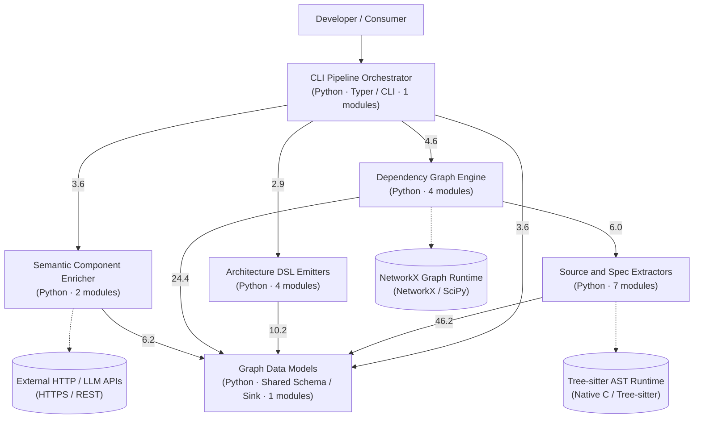

# Architecture & Modularity Report: `project-varuna`

Generated automatically by **Project Varuna** (AST + Centrality Pruning + Louvain Community Detection).

## 1. Executive Summary

| Metric | Value |
| :--- | :--- |
| **Languages Detected** | Python |
| **Source Modules Analyzed (C4)** | 19 (3,614 LOC) |
| **Internal Dependency Edges** | 110 |
| **Discovered C3 Components (Louvain)** | 6 |
| **Cross-Cutting Utility Sinks Pruned** | 1 |
| **Topological / AST Entrypoints** | 1 |
| **Newman-Girvan Modularity ($Q$)** | `0.4012` |
| **Folder-to-Cluster Alignment** | `100.0%` |

---

## 2. C3 Component Architecture (Mermaid Preview)

---

## 3. Discovered C3 Components (Louvain Communities)

| Component ID | Name | Technology | Modules | Cohesion | Dominant Folder | Description |
| :--- | :--- | :--- | :---: | :---: | :--- | :--- |
| `comp_cli` | **CLI Pipeline Orchestrator** | Python · Typer / CLI | 1 (`cli`) | `0%` | `cli` | Provides command-line entrypoints and coordinates the end-to-end architectural analysis workflow. |
| `comp_extractors` | **Source and Spec Extractors** | Python | 7 (`base`, `infra_scanner`, `openapi_parser`, `python_extractor`, `registry`, `ruby_extractor`, `ts_extractor`) | `100%` | `extractors` | Parses source code ASTs, API specifications, and infrastructure configurations into architectural symbols and dependencies. |
| `comp_emitters` | **Architecture DSL Emitters** | Python | 4 (`emitters`, `likec4_emitter`, `report_emitter`, `structurizr_emitter`) | `100%` | `emitters` | Generates LikeC4, Structurizr DSL, and Markdown drift reports from the analyzed architectural graph. |
| `comp_graph` | **Dependency Graph Engine** | Python | 4 (`builder`, `centrality`, `clustering`, `drift`) | `60%` | `graph` | Constructs dependency networks and applies graph algorithms to compute centrality, detect communities, and measure drift. |
| `comp_enrichment` | **Semantic Component Enricher** | Python | 2 (`heuristic_namer`, `llm_agent`) | `100%` | `enrichment` | Infers meaningful names and descriptions for discovered components using heuristic metrics and LLM synthesis. |
| `comp_models` | **Graph Data Models** | Python · Shared Schema / Sink | 1 (`graph_schema`) | `100%` | `models` | Defines domain schemas, node representations, and edge classifications for the architectural knowledge graph. |

---

## 4. Centrality & Cross-Cutting Utility Sinks

Modules with high cross-namespace fan-in and zero/minimal internal outbound coupling are isolated before Louvain clustering so they don't collapse independent domains into a single hairball:

| Module | Path | In-Degree | Out-Degree | PageRank | Authority | Classification Reason |
| :--- | :--- | :---: | :---: | :---: | :---: | :--- |
| `src.varuna.models.graph_schema` | `src/varuna/models/graph_schema.py` | 17 | 0 | `0.0526` | `0.0000` | Cross-cutting sink imported by 17 modules across 6 namespaces (out_degree=0, PageRank=0.053) |

---

## 5. Entrypoint Discovery (3-Tier Boundary Detection)

| Module | Entrypoint Kind | Name | Detail |
| :--- | :--- | :--- | :--- |
| `src.varuna.cli` | `cli_command` | `cli:analyze` | CLI command handler `analyze_command` |
| `src.varuna.cli` | `cli_command` | `cli:inspect` | CLI command handler `inspect_command` |
| `src.varuna.cli` | `cli_command` | `python -m src.varuna.cli` | Main module execution block |
| `src.varuna.cli` | `topological_source` | `root:cli` | Topological source node (in_degree=0, out_degree=4) |

---

## 6. Architecture Drift & Modularity Diagnostics

✅ **Zero Architecture Drift Detected** — Physical folder namespaces align cleanly with Louvain behavioral communities.
